<div align="center">
  
</div>

<br />

<table width="100%">
  <tr>
    <td width="66%" valign="top">
      <h3>yo, i'm divyanshu 👋</h3>
      <p>
        i'm a <b>product builder & open-source contributor</b> who likes shipping fast, zero-bloat software end-to-end. instead of boxing myself into a single language, i jump across the stack—from crafting reactive web & <b>react native</b> interfaces to diving deep into backend systems, llm proxies, and database internals.
      </p>
      <ul>
        <li><b>open source (40+ merged prs):</b> heavy contributor to <a href="https://github.com/clawvisor/clawvisor"><b>clawvisor (yc p26)</b></a> (where most of my prs live), currently hacking on postgres search internals at <a href="https://github.com/paradedb/paradedb"><b>paradedb</b></a>, and shipped across <a href="https://github.com/different-ai/openwork"><b>openwork</b></a>, <a href="https://github.com/mem0ai/mem0"><b>mem0</b></a>, and <a href="https://github.com/c15t/c15t"><b>inth/c15t</b></a>.</li>
        <li><b>industry experience:</b> built clinical dashboards, bullmq queues & aws ses/sns event pipelines at <b>rockethealth</b> (migrated 6k+ users), hardened llm proxy infra at <b>clawvisor</b>, and built ai travel engines at <b>zingvel</b>.</li>
        <li><b>off the clock:</b> watching f1 telemetry, dialing in guitar tones (the 1975 / radiohead), and football tactics.</li>
      </ul>
      <p align="left">
        <a href="https://divyanshusharma.vercel.app/"></a>
        <a href="https://x.com/iamd1v"></a>
        <a href="https://www.linkedin.com/in/divyanshu-sharma-b9b534113/"></a>
        <a href="https://hashnode.com/@divvv"></a>
        <a href="mailto:sharmadivyanshu265@gmail.com"></a>
      </p>
    </td>
    <td width="34%" valign="middle" align="center">
      <pre align="left">
<b>┌──(divyanshu㉿builder)-[~]</b>
<b>└─$</b> cat profile.json
{
  "vibe": "builder / oss",
  "prs_merged": "40+",
  "main_oss": "clawvisor (yc p26)",
  "active_at": "paradedb",
  "ships": [
    "web & react-native",
    "ai agents & proxies",
    "backend & db internals"
  ],
  "drs": "enabled 🏎️"
}</pre>
    </td>
  </tr>
</table>

---

### 🏎️ open-source & engineering log

i like dropping into unfamiliar, high-velocity codebases, figuring out how they tick, and shipping real fixes:

| organization / repo | what i shipped & worked on | repo stack |
| :--- | :--- | :--- |
| 🔴 **[clawvisor (yc p26)](https://github.com/clawvisor/clawvisor)** | **top contributor (most merged prs)** — built & hardened llm proxy infrastructure, resolved high-concurrency sqlite contention under **200+ req/sec** (wal tuning, connection pooling, busy timeouts), added headless runner wait apis with token budgeting, and built reactive approval telemetry panels. | `golang` `sqlite` `typescript` `sse` |
| 🟠 **[paradedb](https://github.com/paradedb/paradedb)** | **active contributor** — working on postgres BM25 search & analytics engine internals, query predicate execution, and memory/filter optimizations. | `rust` `postgresql` `search` |
| 🟣 **[openwork (different-ai)](https://github.com/different-ai/openwork)** | contributed desktop application features, rich release note rendering, and update notification workflows. | `typescript` `react` `desktop` |
| 🔵 **[mem0](https://github.com/mem0ai/mem0) & [inth/c15t](https://github.com/c15t/c15t)** | engineered reactive frontend surfaces, telemetry components, consent/state flows, and developer tooling across 40+ total oss prs. | `typescript` `next.js` `react` |
| 🟢 **rockethealth** | full-stack developer across 5 clinical verticals; built `rocket-mail` with aws ses/sns event tracking, bullmq job queues (invoices, notifications, meta events), and migrated **6k+ users**. | `next.js` `bullmq` `node.js` `aws` |
| ⚪ **zingvel travels** | built interactive flight seat pickers, responsive ticketing flows, and *wanderlust*—an ai-powered travel recommendation engine. | `react` `typescript` `ai` |

---

### 🛠️ things i've built from scratch

projects where i owned the product design, frontend experience, and backend architecture end-to-end:

<table>
  <tr>
    <td width="50%" valign="top">
      <h4>🤖 micromanus</h4>
      <p>
        <b><a href="https://github.com/devcool20">github ↗</a></b> · 
        <b><a href="https://divyanshusharma.vercel.app/">live ↗</a></b>
      </p>
      <p>self-hosted, tenant-isolated autonomous react research agent that searches, scrapes, synthesizes, and compiles structured pdf reports.</p>
      <ul>
        <li>built a ReAct agent with byok provider support, <b>aes-256-gcm</b> key encryption, and precise token billing.</li>
        <li>enforced tenant isolation via supabase rls and integrated stripe credit top-ups.</li>
      </ul>
      <p><code>typescript</code> <code>next.js</code> <code>supabase</code> <code>stripe</code></p>
    </td>
    <td width="50%" valign="top">
      <h4>⚖️ case vault</h4>
      <p>
        <b><a href="https://github.com/devcool20">github ↗</a></b> · 
        <b><a href="https://divyanshusharma.vercel.app/">live ↗</a></b>
      </p>
      <p>full-stack legal-tech case exploration platform with interactive case journey & lineage graph visualizations.</p>
      <ul>
        <li>renders complex relationship timelines, search filters, and graph-style data connections for legal datasets.</li>
        <li>backed by a <b>python fastapi</b> service for searching and inspecting court records.</li>
      </ul>
      <p><code>next.js</code> <code>react</code> <code>python</code> <code>fastapi</code></p>
    </td>
  </tr>
  <tr>
    <td width="50%" valign="top">
      <h4>🎥 stash live</h4>
      <p>
        <b><a href="https://github.com/devcool20">github ↗</a></b> · 
        <b><a href="https://divyanshusharma.vercel.app/">live ↗</a></b>
      </p>
      <p>responsive presenter overlay suite that composites live interactive data cards directly into webcam video for meet & zoom.</p>
      <ul>
        <li>built custom hooks and dynamic canvas/modal rendering with adaptive placement.</li>
        <li>shipped compression-aware rendering, signed image proxying, and typed <b>websocket</b> workflows.</li>
      </ul>
      <p><code>react</code> <code>canvas/webgl</code> <code>websockets</code> <code>typescript</code></p>
    </td>
    <td width="50%" valign="top">
      <h4>📦 loql</h4>
      <p>
        <b><a href="https://github.com/devcool20/loql-web">github ↗</a></b> · 
        <b><a href="https://divyanshusharma.vercel.app/">live ↗</a></b>
      </p>
      <p>peer-to-peer rental marketplace across web and react native with nearby discovery and real-time transaction flows.</p>
      <ul>
        <li>engineered custom hooks and responsive cross-platform flows across web and mobile.</li>
        <li>implemented a secure two-way <b>qr handshake</b> protocol to verify item sharing.</li>
      </ul>
      <p><code>react native</code> <code>react</code> <code>typescript</code> <code>zustand</code></p>
    </td>
  </tr>
</table>

---

### ⚡ tools i build with

<div align="center">
  
</div>

<br />

```yaml
frontend & mobile  : [ react, next.js, react native, typescript, tailwind css, zustand, redux, react query, recharts, d3.js, canvas/webgl ]
backend & systems  : [ node.js, python (fastapi), bullmq, websockets, sse, sqlite (wal/concurrency), postgresql, supabase, golang/rust (oss) ]
tools & workflow   : [ git, github, aws (ses/sns), docker, cursor, claude code, figma ]
